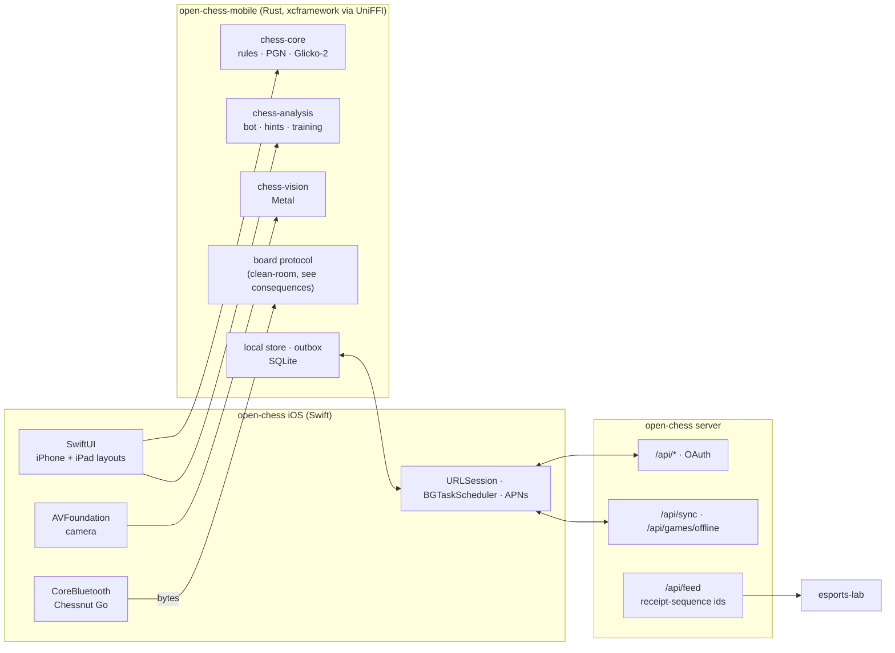

# ADR-0001: Build the iOS app as SwiftUI over the open-chess Rust core

| | |
|---|---|
| **State** | Accepted |
| **Architectural Significance** | HIGH |
| **Domain** | open-chess |
| **Document version** | 1.0 |

## Reference

Standalone open-chess app for iPhone and iPad. Builds on the 13 Oct 2026 decision "open-chess as its own provider to esports" (open-chess 0.1.2, PR #17): open-chess accounts, its own Glicko ratings, the live feed.

## Summary

Ship a native SwiftUI app whose chess, analysis, vision, board protocol, rating and sync logic all come from the open-chess Rust crates through a UniFFI-generated `.xcframework`. The app works fully offline, uploads games and photo labels when a connection allows, and lets the player choose how often it syncs. The server gains an offline-game upload path and a feed id that copes with late uploads.

## Context

open-chess already has everything a chess app needs, in Rust with no I/O:

- `chess-core`: rules, SAN, PGN, clocks, Glicko-2.
- `chess-analysis`: our own engine (search, NNUE, tablebases), the bot levels 1–8, win/draw/loss odds, notation explained, tactical patterns, openings. Nothing GPL is linked.
- `chess-vision`: photo → position on candle, with a `metal` feature.
- `chess-chessnut`: the Chessnut Air/Air+/Pro/Go Bluetooth LE protocol and session.
- `chess-client`: the Lichess-compatible API client, which works against lichess.org and open-chess alike.

The web Chess lab (`web/chess`) runs the same code through `chess-wasm`. An iOS app needs the same features plus things a browser does badly: the camera, Bluetooth LE, background refresh, push, and very slow links (satellite at sea).

Requirements:

- **Play:** offline and online, against the computer or two players on one device; online opponents on open-chess first, Lichess second.
- **Ratings:** open-chess Glicko; offline games update ratings once uploaded.
- **Photos:** read a board from a photo, correct it, send the labelled photo when next online.
- **Low data:** a user-set sync interval (e.g. every 10 minutes or longer) and no photo uploads.
- **Training and hints mode.**
- **Boards:** the Chessnut Go now, others later.
- **Look:** modern, in the open-chess theme.

## Decision makers

- Mark Olliver, maintainer — primary decision maker

## Recommended option

**Option 1: native SwiftUI over a UniFFI Rust core.**

The Rust crates are already I/O-free, so the split is natural:

- **Rust** decides: rules, analysis, vision, board protocol, ratings, and the sync queue in SQLite.
- **Swift** does the I/O and UI: SwiftUI, AVFoundation, CoreBluetooth, `URLSession`, `BGTaskScheduler`, APNs, Keychain.

This is the only option that gives good camera, Bluetooth, background and iPad behaviour without fighting the platform. The cost is a second UI codebase alongside `web/chess`.

### What the app does

| Feature | How |
|---|---|
| Offline: vs computer | `chess-analysis` bot levels 1–8 on device. |
| Offline: two players | One device. iPhone flips the board after each move; iPad can use a face-to-face layout. |
| Online opponents | open-chess first (quick pairing, challenges, correspondence), Lichess second ("Also play on Lichess", its own OAuth and Board API). Lichess games are rated on Lichess and stored unrated on open-chess. |
| Offline games rated | Upload with move timestamps (plus the board's move log when a board was used) and an App Attest token. Bot games count against the level's fixed rating (`Level::rating`, 800–2200), decided 14 Oct 2026: the level is known, and Glicko gives little for beating a bot far below you; two-player games need the second player's confirmation (sign-in on the device or a QR code from their phone). Games with hints or takebacks are unrated. |
| Ratings | open-chess Glicko-2 per speed. The app caches rating and RD at each sync and updates them provisionally offline ("1642?"). A player with no history starts at the Glicko default. The server rates uploads against the player's current rating and its figures replace the provisional ones. |
| Photos | `chess-vision` on device (Metal) → board editor to correct → outbox (crop, corrected FEN, model version, confidence). The app asks for the [photo licence](../photo-licence.md) before keeping any photo. It crops to the board and strips EXIF and GPS before upload. |
| Low data | Sync interval (manual, 1, 5, 10, 30 or 60 min), photo uploads off, Wi-Fi-only uploads, data cap. Switches on when `NWPathMonitor` reports a constrained or expensive path. Online play is limited to correspondence time controls; "your move" arrives by push. |
| Training and hints | `chess-analysis`: five best lines, win/draw/loss bar, notation explained, patterns, openings. Blocked in rated online games. |
| Boards | Chessnut Go over CoreBluetooth; a `Board` trait for more later. Bluetooth LE boards only. |
| Look | The deployment's Chess lab theme (the `CHESS_APP_THEME` tokens: paper, panel, ink, squares, action, amber, danger, arrows, W/D/L segments) as an asset catalog with light and dark, so the app matches whichever site it signs in to. For esports that is `deploy/chess/app-theme.css`: royal navy and orange, dark by default, Inter with JetBrains Mono for numbers, square corners. iPad: board left, analysis and moves right. iPhone: stacked. |

### Server changes

| Change | Why |
|---|---|
| `POST /api/games/offline` | Batched upload with idempotency keys, timestamps, flags, attestation, confirmations. Replies per game: rated, pending confirmation, or unrated. |
| `POST /api/games/{id}/confirm` | The second player confirms a two-player result. |
| `GET /api/sync?since=` | One compressed delta for ratings, games, challenges and correspondence moves: cheaper than holding `/api/feed` open over satellite. |
| Contributor photo upload | `/api/esl/photos` is the reviewers' API; players need an upload endpoint. |
| **Feed ids become a receipt sequence** | Today an `end` event's id is when the game *finished*. A game uploaded three days late gets an id behind esports' `chess_feed` cursor and is never delivered. Keep the finish time as a field. |
| APNs sender | "Your move" for correspondence play. |
| In-app account deletion | Required by App Store review. |

## Options considered + consequences

### Option 1: Native SwiftUI over a UniFFI Rust core

**Description:** a new Cargo feature or crate, `open-chess-mobile`, exposes the core through UniFFI. CI builds an `.xcframework` for `aarch64-apple-ios` and the simulator and publishes it as a Swift package. The app lives in its own repo, `open-chess-ios`.

**Consequences:**
- Pros: full camera, Bluetooth LE, background and push support; native iPad multitasking; Metal for vision through candle's existing `metal` feature; the Rust crates stay the single source of chess behaviour.
- Cons: a second UI codebase to keep in step with `web/chess`; Swift in the stack (kept out of the open-chess repo).
- Build cost: macOS runners use GitHub Actions minutes at about 10× the Linux rate. Build the xcframework on release tags only, and the app locally or on tags.

### Option 2: Tauri 2 around the existing web Chess lab

**Description:** ship `web/chess` and `chess-wasm` (or native Rust) inside a Tauri iOS shell.

**Consequences:**
- Pros: one UI for web and iOS; the most reuse; almost no Swift.
- Cons: the camera, CoreBluetooth, background tasks and push all need plugins or Swift glue anyway; WKWebView limits; weaker iPad layouts; App Store reviewers look harder at web wrappers.

### Option 3: Progressive web app only

**Description:** improve the offline Chess lab and add it to the home screen.

**Consequences:**
- Pros: no app review; nothing new to build or ship.
- Cons: no Bluetooth LE in Safari, so no Chessnut board; no reliable background sync; no low-data-mode detection. It fails three of the requirements.

### Consequences of the recommended option that need action

- **Licence: relicense `chess-chessnut` as MIT OR Apache-2.0.** It is GPL-3.0-or-later only because its protocol knowledge came from PicoChess; it holds no PicoChess code or behaviour, just the Chessnut byte protocol and a debouncing session. PicoChess support already lives in `chess-device` (`pico.rs`, `picoini.rs`), which stays GPL, so no split or duplicated code is needed. Before relicensing, confirm the crate was written fresh rather than translated from PicoChess, and cross-check its byte values against the Go itself. Do it after the current driver fix. Check every crate in the xcframework with `cargo deny` against an allow-list with no GPL.
- **Sign-in:** open-chess accounts only, through `ASWebAuthenticationSession` and OAuth PKCE (`ocp_` tokens). Players belong to open-chess (decided 14 Oct 2026), so the app offers no "Sign in with esports"; an app's own accounts don't need Sign in with Apple alongside.
- **Trust:** offline results are easier to fake than online ones. App Attest, move timestamps, board logs, second-player confirmation and fair-play screening reduce that risk without removing it.
- **Late games:** rated when they arrive, against current ratings, not by rewriting history.
- **Boards:** Bluetooth LE only. DGT USB and classic-Bluetooth boards would need Apple MFi certification.

## Document version history

| Version | Date | Notes |
|---------|------|-------|
| 0.1 | 2026-10-14 | Initial draft. Ratings, offline-game and Bluetooth LE scope settled in discussion the same day. |
| 1.0 | 2026-10-14 | Accepted: Option 1. Chessnut licence handled by relicensing `chess-chessnut` rather than a clean-room rewrite. |
