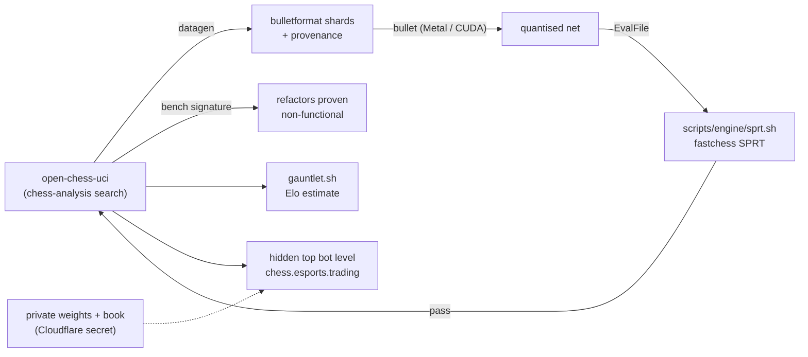

# ADR-0002: Strengthen the engine by measured search work and a self-trained NNUE

| | |
|---|---|
| **State** | Accepted |
| **Architectural Significance** | HIGH |
| **Domain** | open-chess |
| **Document version** | 1.1 |

## Reference

The private bot plan of 15–16 Oct 2026 (esports project: "Private chess engine — strength plan"). Builds on ADR-0001 (the iOS app uses the same `chess-analysis` crates) and on the engine and distributed-training work already in `crates/chess-analysis` and `crates/chess-train`.

## Summary

The engine's strength comes from the existing `chess-analysis` search, improved one measured change at a time, and an evaluation network trained with bullet on our own self-play data (optionally labelled by Stockfish or Leela, which are tools, never dependencies). The top mode is pure strength and deterministic; variety and personality live in the bot levels. The engine ships as its own program, `open-chess-uci`, which is also the data generator and benchmark, so every machine, rented or owned, runs one binary. Strength claims come only from the test rig in `scripts/engine/`. Private weights and books stay out of the repository and load from secrets; the engine itself stays open in open-chess.

## Context

The esports bot should beat every bot a player meets on open-chess or Lichess. Three ideas were considered and set aside on the way:

- **Hand-set piece values with a "keep high-value pieces" rule.** Weaker than the tapered evaluation already in `eval`, and far weaker than a trained network, which learns compensation (initiative, king exposure, passed pawns) that fixed values cannot express. It is also what makes an engine refuse good sacrifices.
- **A fixed 7-move look-ahead over ten candidate lines.** Alpha-beta with iterative deepening, quiescence, a transposition table and pruning reaches 20+ plies in the same time and re-searches from scratch every move; the engine already does this, and MultiPV already gives the candidate lines.
- **Learning during play.** No top engine learns online; strength is search plus a network trained offline, measured by games.

A survey of the repository on 16 Oct 2026 answered the plan's open questions:

| Question | Finding |
|---|---|
| UCI front end and `bench`? | A minimal UCI example only; no bench. Both now in `crates/chess-uci`. |
| Which search features are in? | All of the plan's Phase 1 list: aspiration windows, TT with depth-preferred replacement, PVS, null-move, reverse futility, futility, LMR/LMP, SEE pruning, check extensions, killers/countermoves/history with gravity, continuation history, correction history, singular extensions, lazy SMP, soft/hard time management, three-piece tablebases. Singular extensions, continuation history, correction history and best-move-stability time management ship switched off behind parameters until SPRT turns them on. |
| Tested rather than assumed? | The in-process SPRT/SPSA/datagen library and merging server exist; no gauntlet result is recorded in the repository. Phase 0's baseline number is still to be produced. |
| Speed | About 0.3 M nodes/s on one core (depth-10 bench); the top Rust engines run several times that. Speed is a strength lever alongside the network. |
| Repository for the private engine | The engine stays open in open-chess. Only the trained weights and the private book are secrets (as the fair-play model is). No private crate. |
| OpenBench or an own queue | Undecided; `open-chess-uci` prints the OpenBench SPSA format (`tune`) and its bench line, so either works. Decide at milestone M3. |
| Does `chess-vision` data help strength? | No. Photo data serves fair play and training mode. |

## Decision makers

- Mark Olliver, maintainer — primary decision maker

## Recommended option

**Option 1: keep the one engine, measure everything, train our own network.**

Implemented in the first step (Phase 0 of the plan):

| Piece | Where |
|---|---|
| The engine as a UCI program with every tunable as an option, live `info` lines (a new `Searcher::set_on_iteration` callback), `Hash`, `Threads`, `MultiPV`, `EvalFile`, `UseTablebases` | `crates/chess-uci` → `open-chess-uci`, in every release |
| `bench`: 51 fixed positions to depth 10, the node signature and nps | `open-chess-uci bench`; `scripts/engine/bench.sh` compares two builds |
| Self-play data in bullet's 32-byte binary format, balanced openings only, provenance sidecar | `chess_train::bulletformat`, `chess_train::datagen::play`; `open-chess-uci datagen` |
| SPRT, gauntlet and setup scripts around fastchess | `scripts/engine/` |
| bullet trainer configuration matching `nnue::Network`'s quantisation | `training/bullet/open_chess.rs`, `training/README.md` |

### Rules the option fixes

- One change per SPRT; bounds `[0, 5]` for gains, `[-5, 0]` for simplifications; fixed seeds, UHO book, 16 MB hash, one thread each, no engine book. A changed bench signature is a search change.
- The strength mode is deterministic apart from the opening book. Temperature, style choosers over MultiPV and the slip margins stay in bot levels 1–8.
- Each generation's network is trained from scratch on all data so far, with the data's provenance kept; search and network changes are tested in separate runs so each gain is attributable.
- `cargo deny` keeps GPL and AGPL out of everything the engine links. Reckless (AGPL) and Stockfish (GPL) are gauntlet opponents and labellers only.
- Training runs on the M5 (bullet's Metal backend, cross-checked against the CPU backend on short runs); data generation and testing move to the cheapest rented Linux CPU nodes when the laptop is the limit (milestone M6).

## Options considered + consequences

### Option 1: One engine, measured, self-trained network

**Consequences:**
- Pros: the search, bot, fair-play worker, web app and iOS app all share one engine that gets stronger together; nothing new to licence; every result reproducible from a sidecar and a commit.
- Cons: a strong network needs hundreds of millions to billions of positions, which is weeks of core time; the speed gap to the top Rust engines is real engineering work (move generation, NNUE inference with NEON/AVX2, accumulator updates).

### Option 2: Run Stockfish behind the server as the top bot

**Description:** the server already drives Stockfish for fair-play screening; make it the strongest level.

**Consequences:**
- Pros: 3600-strength today, no training.
- Cons: GPL stops it going into the iOS app or the web engine, so the bot would differ from what players train against offline; nothing is learnt; no path to the fair-play model sharing the engine. Kept as a measuring tool and labeller only.

### Option 3: Wrap Reckless or Viridithas

**Description:** use a top Rust engine's search with our network, or outright.

**Consequences:**
- Pros: the strongest Rust search available.
- Cons: Reckless is AGPL-3.0 (its network clause would oblige source for the server), Viridithas is GPL; neither can be linked. Reading their public descriptions of techniques is fine and is how the search was written.

### Consequences of the recommended option that need action

- **Baseline (M0):** run `scripts/engine/setup.sh` and `gauntlet.sh` on the M5 and record the number in the plan. Nothing in Phase 1 starts before it.
- **Switch on the shipped-off features by test:** `se_depth`, `cont_hist`, `corr_hist`, `time_stable` each get an SPRT.
- **Speed:** profile the bench; move generation and evaluation are the likely costs. Any speed-up is proven by an unchanged signature plus higher nps.
- **First network:** a few million positions, `HIDDEN_SIZE = 256`, CPU backend, to prove the format round-trips; then Metal against CPU on a short run; then the real run.
- **Private deployment:** a `CHESS_BOT_NET` secret (and later a book) read at start-up by the server's bot, falling back to the public net. Not yet built.
- **Short clocks (resolved):** games at a one-second base were lost on time. Instrumenting a game showed one move of 1.1 s against a 14 ms plan: the three-piece tablebases were being built on first probe, inside the search and outside the clock. `open-chess-uci` now builds them at start-up (`Searcher::prepare_tablebases`, about a second before `uciok`), subtracts a `Move Overhead` (default 10 ms) from each move's plan, and plays new moves onto the previous `position` instead of replaying the game. Per-move overruns are now a few milliseconds. The web app keeps building on demand, where there is no clock.

## Document version history

| Version | Date | Notes |
|---------|------|-------|
| 1.0 | 2026-10-16 | Accepted with the Phase 0 implementation: `open-chess-uci`, bench, bulletformat datagen, test rig, bullet configuration. |
| 1.1 | 2026-10-16 | Time losses at short clocks traced to on-demand tablebase builds; fixed. |
